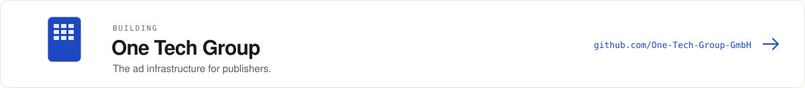

<a href="https://onetech.group">
  <picture>
    <source media="(prefers-color-scheme: dark)" srcset="./assets/header-dark.svg">
    
  </picture>
</a>

  <a href="https://www.linkedin.com/in/lucaslingensll/"><picture><source media="(prefers-color-scheme: dark)" srcset="./assets/btn-linkedin-dark.svg"></picture></a>
  <a href="https://onetech.group"><picture><source media="(prefers-color-scheme: dark)" srcset="./assets/btn-web-dark.svg"></picture></a>
   
  <picture><source media="(prefers-color-scheme: dark)" srcset="./assets/open-to-dark.svg"></picture>

### What I build

<picture>
  <source media="(prefers-color-scheme: dark)" srcset="./assets/focus-dark.svg">
  
</picture>

<a href="https://github.com/One-Tech-Group-GmbH">
  <picture>
    <source media="(prefers-color-scheme: dark)" srcset="./assets/org-card-dark.svg">
    
  </picture>
</a>

### How I work

<picture>
  <source media="(prefers-color-scheme: dark)" srcset="./assets/terminal-dark.svg">
  
</picture>

### Stack

  
  
  
  
  
  
  
  
  
  
  

### Open source

<a href="https://github.com/onetechgroupll/eigen-beam">
  <picture>
    <source media="(prefers-color-scheme: dark)" srcset="./assets/oss-eigen-beam-dark.svg">
    
  </picture>
</a>

### Contributions

<picture>
  <source media="(prefers-color-scheme: dark)" srcset="https://raw.githubusercontent.com/onetechgroupll/onetechgroupll/output/stats-dark.svg">
  
</picture>

<picture>
  <source media="(prefers-color-scheme: dark)" srcset="https://raw.githubusercontent.com/onetechgroupll/onetechgroupll/output/snake-dark.svg">
  
</picture>

<picture>
  <source media="(prefers-color-scheme: dark)" srcset="https://raw.githubusercontent.com/onetechgroupll/onetechgroupll/output/skyline-dark.svg">
  
</picture>

Most of my work lives in private repos. Graphics are hand-built SVG in the <a href="https://github.com/One-Tech-Group-GmbH/otg-design-system">OTG Design System</a> palette. Stats and the skyline (time of day + live weather via Open-Meteo) rebuild hourly. Regenerate with <code>python3 tools/build_svgs.py</code>.
